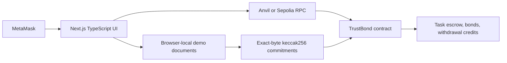

# TrustBond

TrustBond is a semester-project Ethereum application for accountable AI and automated service work. A client funds a task, a registered provider reserves a refundable bond and submits a result commitment, and the client approves or disputes the result. A designated reviewer can split the escrow payment and forfeit a capped part of the bond. The contract records the agreement, money, task state, and settlement. It cannot judge whether an AI answer is correct, truthful, or safe.

**Demo only: use Anvil or Sepolia test ETH. Do not use real funds or deploy to mainnet.** TrustBond does not implement ERC-8004.

## Features and non-goals

Providers register public profile commitments, deposit bonds, reserve bond for accepted tasks, withdraw free bond, and view raw reputation counters. Clients fund tasks with deadlines and acceptance criteria, then approve or dispute submitted work. A named reviewer can decide a disputed task with a payment split and capped bond forfeiture. Timeout paths release escrow when a participant does not act. All payouts use pull withdrawals.

Any registered provider with enough free bond may accept an open task; the first successful acceptance assigns that provider. The client chooses one reviewer at creation; the provider sees that choice before accepting. The MVP has no token, fee, administrator override, reviewer registry, automated quality oracle, appeal process, permanent file hosting, or production deployment.

## Architecture



One non-upgradeable `TrustBond` contract combines provider registry and task escrow because both use the same bond and payment ledger. This avoids cross-contract authorization and transfers. OpenZeppelin `ReentrancyGuard` protects both external withdrawal functions. Settlement only credits balances. The UI reads bounded on-chain task/provider records and real events; contract checks remain authoritative.

### Contract state machine

| State | Action | Actor and deadline | Result |
| --- | --- | --- | --- |
| None | Create and fund | Client; acceptance deadline before work deadline | Open, payment locked |
| Open | Accept | Eligible provider, through acceptance deadline | Accepted, bond reserved |
| Open | Cancel | Client, through acceptance deadline | Cancelled, client refund credited |
| Open | Expire | Anyone, after acceptance deadline | Expired, client refund credited |
| Accepted | Submit | Assigned provider, through work deadline | Submitted, review starts |
| Accepted | Claim work timeout | Anyone, after work deadline | Settled, client refund and agreed maximum bond forfeiture credited |
| Submitted | Approve | Client, through review deadline | Settled, full payment credited to provider |
| Submitted | Dispute | Client, through review deadline | Disputed, evidence commitment recorded |
| Submitted | Claim review timeout | Anyone, after review deadline | Settled, full payment credited to provider |
| Disputed | Decide | Named reviewer, within seven days | Settled, chosen payment split and capped bond forfeiture credited |
| Disputed | Claim reviewer timeout | Anyone, after seven days | Settled, full client refund and bond release |

Original actions are valid at their exact deadlines; timeouts are valid strictly afterward. No state settles twice. Cancelled and Expired are terminal. The reviewer chooses a provider payout from 0 to 10,000 basis points; the client receives the remainder. Bond forfeiture is independent, capped when the task is created, and always credited to the client. One client rating is allowed after an assigned task reaches Settled.

### On-chain and off-chain data

| On-chain, public | Off-chain |
| --- | --- |
| Role addresses, state, payment, bond amounts, deadlines, settlement, and reputation counters | Provider name, description, capabilities, and response estimate |
| URIs and `bytes32` keccak256 commitments | Task title, category, description, acceptance checklist, dispute reason, reviewer rationale, result files |
| Typed events and transaction history | Browser-local demo documents or user-supplied external references |

Application-created documents are serialized once as compact JSON with fixed key order, encoded as UTF-8, and hashed with keccak256. The checklist is separately hashed as a compact JSON array. Files are hashed as raw bytes; text is hashed as exact UTF-8 bytes without normalization. Verification compares the received or selected bytes, not a reserialized object. A matching hash proves byte equality only; it does not prove correctness, truth, safety, ownership, or availability.

The default `local://` URI stores committed bytes in this browser only. It is a **local demo reference**, not IPFS or permanent hosting. Another browser may see the on-chain hash while the document remains unavailable. Do not put private evidence, personal information, or secrets into public on-chain fields or URIs.

## Requirements and versions

Install Node.js 26, npm, [Foundry](https://getfoundry.sh/introduction/installation/) (`forge`, `anvil`, `cast`), and MetaMask. Next.js 16 needs at least Node.js 20.9. `package-lock.json` pins the npm dependency tree; `foundry.toml` pins Solidity 0.8.38.

| Tool or package | Version used locally |
| --- | --- |
| Foundry / Solidity | 1.9.0 / 0.8.38 |
| Node.js / npm | 26.12.0 / 11.20.0 |
| OpenZeppelin Contracts | 5.4.0 |
| Next.js / React | 16.4.6 / 19.3.1 |
| Tailwind CSS | 4.3.5 |
| wagmi / viem | 2.19.5 / 2.58.0 |

At the repository root, run `npm ci`, then `forge build` and `forge test`. `npm ci` installs OpenZeppelin for the Foundry remapping as well as the web dependencies. If `node --version` reports Node.js 18, select Node.js 26 before running npm. Foundry downloads the configured compiler on first build if it is not cached.

## Local Anvil demo

1. Run `anvil --chain-id 31337 --block-time 2` in one terminal and leave it running. The two-second block interval lets review deadlines advance even when nobody sends a transaction. Its accounts and keys are disposable local demo material. Never reuse those keys on a public network.
2. Run `cast rpc eth_accounts --rpc-url http://127.0.0.1:8545` in another terminal and choose an address. Deploy with `forge script script/Deploy.s.sol:Deploy --rpc-url http://127.0.0.1:8545 --broadcast --unlocked --sender <ANVIL_ADDRESS>`. This uses Anvil's unlocked account and keeps keys out of the command and repository.
3. Copy `.env.example` to `.env.local`. Set `NEXT_PUBLIC_CHAIN_ID=31337`, `NEXT_PUBLIC_ANVIL_CONTRACT_ADDRESS` to the actual deployed address, and `NEXT_PUBLIC_ANVIL_DEPLOYMENT_BLOCK` to the receipt block. Run `cast receipt <DEPLOYMENT_TX_HASH> --rpc-url http://127.0.0.1:8545` to inspect both. Leave Sepolia fields blank.
4. Run `npm run dev` and open `http://127.0.0.1:3000`. In MetaMask, add RPC `http://127.0.0.1:8545` with chain ID `31337`. Import three different disposable Anvil accounts for provider, client, and reviewer. Restart Next.js after changing `NEXT_PUBLIC_` values.

If no address is configured, the UI shows setup instructions and disables writes. Restarting Anvil without saved state removes the contract and task history; redeploy and update the address/block.

### Three-wallet browser checklist

1. Provider: register a profile, deposit test ETH as bond, and inspect total, reserved, and available bond.
2. Client: create a funded task with criteria, two deadlines, review period, bond requirement, forfeiture cap, and the reviewer's address. Open the task from the confirmed transaction receipt.
3. Provider: inspect the task and reviewer, accept, submit a result reference and hash, and verify reserved bond cannot be withdrawn.
4. Client: inspect the result and open one dispute with a reason and evidence commitment.
5. Reviewer: connect the named wallet, inspect terms and evidence, choose a split and capped forfeiture, add a rationale, and confirm settlement.
6. Client and provider: withdraw credited test ETH. Provider: withdraw only remaining unreserved bond.
7. Client: leave one rating. Provider: inspect task history, settled-task count, dispute outcome, and rating average.

An unrelated wallet should have no approve or reviewer-decision action. Inspect real event and transaction links in the activity view. Missing local documents must be labeled unavailable.

## Sepolia testnet demo

Use **test ETH only** and separate test wallets. Choose a Sepolia RPC endpoint and import a test deployment signer into a local encrypted Foundry keystore with `cast wallet import trustbond-sepolia --interactive`; enter the test key only at its hidden prompt. Never put it in a shell command, environment example, screenshot, or Git file. Deploy with:

```sh
forge script script/Deploy.s.sol:Deploy --rpc-url <SEPOLIA_RPC_URL> --broadcast --account trustbond-sepolia
```

Set `NEXT_PUBLIC_CHAIN_ID=11155111`, `NEXT_PUBLIC_SEPOLIA_CONTRACT_ADDRESS`, `NEXT_PUBLIC_SEPOLIA_DEPLOYMENT_BLOCK`, and `NEXT_PUBLIC_SEPOLIA_RPC_URL` in `.env.local`, then restart the frontend. Sepolia transaction links use Etherscan. This repository contains no public deployment address. Public RPCs may rate-limit a live class demo.

## Commands and test evidence

```sh
npm run dev
npm test
npm run test:coverage
npm run typecheck
npm run lint
npm run build
forge build
forge test
forge coverage
npm run test:e2e
```

For the Playwright lifecycle test, use a **fresh disposable Anvil chain and deployment** from the local setup, with `.env.local` configured. The lifecycle test registers fixed disposable Anvil roles, so a repeat run needs a fresh chain; it never resets your existing demo state for you. Start `npm run dev` in one terminal. In another terminal run `E2E_ANVIL=1 npm run test:e2e`; the test uses unlocked Anvil accounts through a test-only injected wallet. The ordinary `npm run test:e2e` command also requires this flag for the lifecycle case. These are available commands, not claims that every one passed in every environment. Actual RED/GREEN commands and outputs are recorded in [TDD_EVIDENCE.md](TDD_EVIDENCE.md).

## Reputation and limitations

The contract stores raw counters, not a synthetic trust score. `tasksAccepted` counts acceptances. `tasksCompleted` counts assigned tasks that settle, including a missed-work timeout, so the UI labels this **settled tasks**. `onTimeCompletions` counts timely result submissions regardless of payment outcome. `clientApprovals` counts explicit approvals only. Reviewer decisions count as wins, losses, or splits according to the provider payout basis points. A client may rate once from 1 to 5 after settlement; the average is `ratingSum / ratingCount`, with no average before any ratings. These records summarize interactions, not identity or future quality.

The reviewer can be unavailable or biased. After seven days without a decision, a full client payment refund and bond release can be unfair to a provider who delivered work. A missed work deadline refunds payment and forfeits the agreed cap to the client. There is no Sybil resistance, appeal, identity check, automated evidence validation, contract audit, or production security guarantee. Local documents can disappear when browser storage is cleared. Bounded listing and history scans suit a class demo and may omit older records.

## Screenshots and team

Add dashboard, funded task, submission, dispute decision, and settlement screenshots under `screenshots/` before presenting. Remove or blur any non-disposable wallet identifiers; never capture keys or seed phrases.

| Contribution | Team member |
| --- | --- |
| Smart contract and tests | [Name] |
| Frontend and UX | [Name] |
| Demo, documentation, and review | [Name] |
